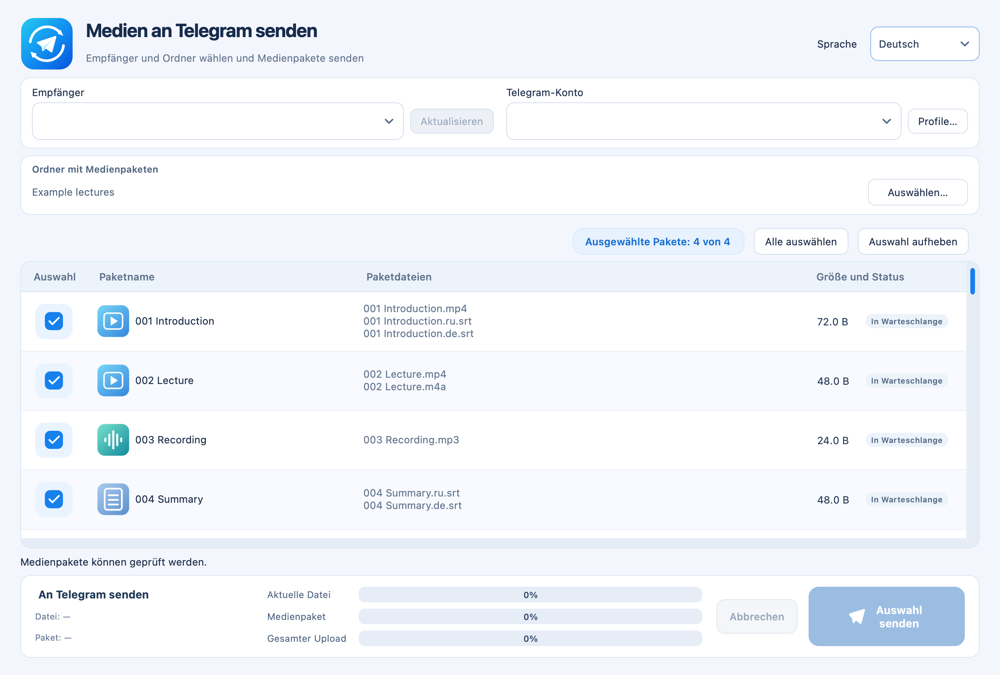

# Telegram Media Sender

**[Deutsch](README.md)** · **[Русский](README.ru.md)** · **[English](README.en.md)**

<!-- public-release:start -->
Sendet nummerierte Pakete aus Video, Audio und Untertiteln in der gewählten Reihenfolge an Telegram.

**macOS 13+ · Apple Silicon · Release 1.1.2**

**[Herunterladen](https://github.com/popovantondev/TelegramMediaSender/releases/tag/v1.1.2)** · **[Anleitung](https://popovantondev.github.io/TelegramMediaSender/Guide-de.html)** · **[Fehler melden](https://github.com/popovantondev/TelegramMediaSender/issues/new/choose)**

**Voraussetzungen und Grenzen:** Eigenes Telegram-Konto, API ID und API Hash erforderlich; keine Apple-Notarisierung.

**Erste Schritte:** ZIP entpacken, Telegram Media Sender.app nach Applications verschieben und die Verbindung nach Anleitung einrichten.

**App-Dateien:**

- [`TelegramMediaSender-1.1.2-macOS-arm64.zip`](https://github.com/popovantondev/TelegramMediaSender/releases/download/v1.1.2/TelegramMediaSender-1.1.2-macOS-arm64.zip)

**Prüfsummen:** [`SHA256SUMS.txt`](https://github.com/popovantondev/TelegramMediaSender/releases/download/v1.1.2/SHA256SUMS.txt)
<!-- public-release:end -->


Apple Silicon (M1 oder neuer) · macOS 13+ · Version 1.1.2

**Telegram Media Sender** ist eine macOS-App, die geordnete Stapel lokaler Dateien an Telegram-Chats sendet. Ein nummeriertes Paket kann Video, Audio, Untertitel oder eine beliebige Kombination davon enthalten. Die App listet Chats, in denen das angemeldete Konto schreiben darf, lässt Sie Pakete auswählen und zeigt den Upload-Fortschritt.

Beim ersten Start wählt die App Deutsch, Russisch oder Englisch passend zur macOS-Sprache. Im Fenster können Sie eine andere Sprache wählen; zum Übernehmen starten Sie die App neu. Die Fensterposition wird gespeichert.



*Oberfläche mit Beispieldateien. Es ist kein Telegram-Konto verbunden; es wurden keine Dateien hochgeladen.*

## Was Sie senden können

| Anwendungsfall | Beispieldateien | Ergebnis |
| --- | --- | --- |
| Vorlesungsaufnahmen | `001 Einführung.mp4`, `002 Vorlesung.mp4` | Zwei Pakete, in numerischer Reihenfolge gesendet |
| Video und separates Audio | `003 Vorlesung.mp4`, `003 Vorlesung.m4a` | Ein Paket mit beiden Dateien |
| Video mit Untertiteln | `004 Lektion.mp4`, `004 Lektion.ru.srt`, `004 Lektion.de.srt` | Ein Paket mit Video und Untertiteln |
| Nur Untertitel | `005 Notizen.ru.srt`, `005 Notizen.de.srt` | Ein Paket nur mit Untertiteln |

## Downloads

Laden Sie den Apple-Silicon-Build für macOS 13 oder neuer unter [Releases](https://github.com/popovantondev/TelegramMediaSender/releases/tag/v1.1.2) herunter. Die aktuelle Version ist **1.1.2**. Entpacken Sie die ZIP-Datei und verschieben Sie **Telegram Media Sender.app** in den Ordner „Programme“.

Der Build ist nicht von Apple notarisiert. Die Schritte für den ersten Start stehen im [Benutzerhandbuch](docs/de/README.md).

## Schnellstart

1. Installieren Sie einen Release-Build und öffnen Sie **Telegram Media Sender**.
2. Legen Sie eine Telegram-API-Anwendung an und tragen Sie API ID und API Hash in einem Profil ein. Die Schritte stehen unter [Telegram verbinden](docs/de/telegram-setup.md).
3. Geben Sie den Anmeldecode ein, den Telegram an Ihr Konto sendet, und bei Nachfrage Ihr Passwort für die Zwei-Schritt-Verifizierung.
4. Wählen Sie einen Ordner mit nummerierten Dateien, laden Sie Ihre Chats, wählen Sie Ziel und Pakete und senden Sie.

Die App enthält weder API-Schlüssel noch ein Telegram-Konto. Profildaten und Telegram-Sitzungen liegen im eigenen Ordner der App unter `~/Library/Application Support/TelegramMediaSender`. Die Profilauswahl ist leer, bis ein benanntes Profil existiert. Beim ersten Start können ausdrücklich benannte, kompatible Profile samt SQLite-Sitzungen aus der Vorgängerversion der App in diesen Ordner kopiert werden; die Daten der Vorgängerversion bleiben erhalten. Das unbenannte Standardkonto wird nicht automatisch übernommen. Profile lassen sich über **Profile… → Löschen…** entfernen. Eine Sitzungsdatei ist sensibel: Wer sie erhält, kann möglicherweise auf das Telegram-Konto zugreifen. Geben Sie sie nicht weiter und laden Sie sie nicht in dieses Repository hoch.

## Unterstütztes Ordnerlayout

Geben Sie zusammengehörigen Dateien dieselbe führende Nummer, damit sie ein Paket bilden. Pakete werden in numerischer Reihenfolge gesendet. Zum Beispiel:

```text
001 Lektion.ru.mp4
001 Lektion.ru.srt
001 Lektion.de.srt
001 Lektion alternativ.srt
```

Unterstützte Medien: MP4, M4V, MOV, MKV, WebM, AVI, M4A, MP3, AAC, OGG, WAV und FLAC. Ein Paket kann auch nur Medien oder nur `.srt`-Untertitel enthalten. Untertitelnamen dürfen leicht abweichen; Dateien mit derselben führenden Nummer werden zusammengefasst. Alle passenden Untertitel werden gesendet; bei mehreren Dateien für dieselbe Sprache warnt die App. Vor dem Upload vergleicht die App Dateinamen und Größen mit dem Verlauf des gewählten Chats und fragt bei einem möglichen Treffer nach.

## Technik

- Python 3.12+
- PySide6 / Qt für die macOS-Oberfläche
- Telethon für die MTProto-API von Telegram
- PyInstaller für das eigenständige macOS-Paket

## Aus dem Quellcode bauen

Auf einem Mac mit Xcode Command Line Tools und Python 3.12:

```bash
git clone https://github.com/popovantondev/TelegramMediaSender.git
cd TelegramMediaSender
bash scripts/build_macos.sh
```

Das App-Bundle wird in `dist/` geschrieben. Hinweise für Entwickler: [Deutsch](docs/de/development.md), [English](docs/en/development.md), [Русский](docs/ru/development.md).

## Dokumentation

- [Deutsch](docs/de/README.md) · [Telegram verbinden](docs/de/telegram-setup.md)
- [Русский](docs/ru/README.md) · [Подключение Telegram](docs/ru/telegram-setup.md)
- [English](docs/en/README.md) · [Connect Telegram](docs/en/telegram-setup.md)
- [Änderungsprotokoll (English)](CHANGELOG.md)

## Rückmeldung

[Fehler melden oder Funktion vorschlagen](https://github.com/popovantondev/TelegramMediaSender/issues/new/choose). Sie können Deutsch, Russisch oder Englisch schreiben. Nennen Sie die App- und die macOS-Version und entfernen Sie persönliche Angaben aus Screenshots.

[Release-Prüfung und Checkliste für einen weiteren Mac](docs/release-check.md).

## Rechte und Software von Drittanbietern

Dieses Projekt hat keine Open-Source-Lizenz. Die öffentliche Verfügbarkeit erlaubt weder Wiederverwendung noch Änderung, Weitergabe oder Verkauf des Quellcodes. Das Release-Binary darf für den persönlichen Gebrauch heruntergeladen und ausgeführt werden. Siehe [RIGHTS.md](RIGHTS.md) (English) und die [Hinweise zu Drittanbietern](THIRD_PARTY_NOTICES.md) (English).
