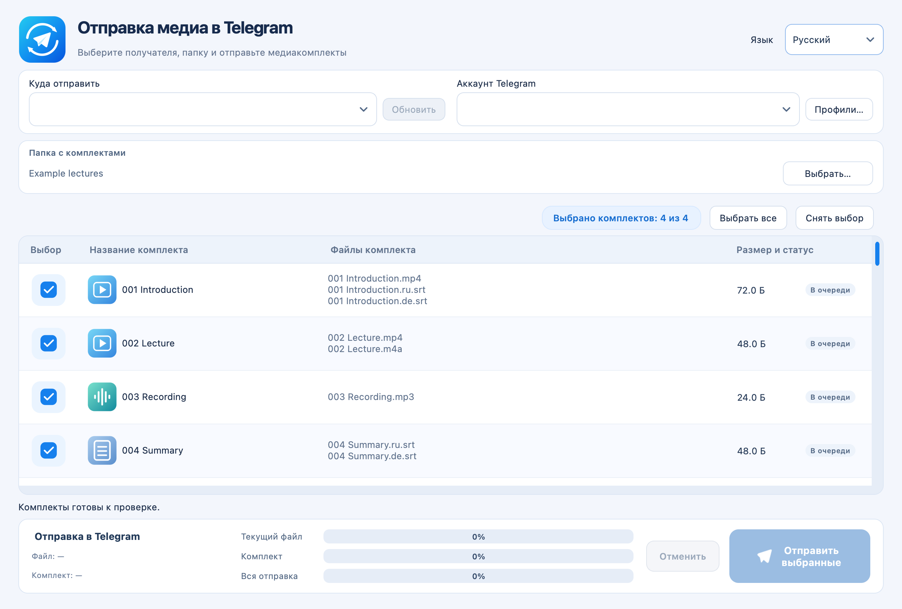

# Telegram Media Sender

**[Deutsch](README.md)** · **[Русский](README.ru.md)** · **[English](README.en.md)**

<!-- public-release:start -->
Отправляет пронумерованные наборы видео, аудио и субтитров в Telegram в выбранном порядке.

**macOS 13+ · Apple Silicon · Выпуск 1.1.2**

**[Скачать](https://github.com/popovantondev/TelegramMediaSender/releases/tag/v1.1.2)** · **[Инструкция](https://popovantondev.github.io/TelegramMediaSender/Guide-ru.html)** · **[Сообщить об ошибке](https://github.com/popovantondev/TelegramMediaSender/issues/new/choose)**

**Требования и ограничения:** Нужны собственный аккаунт Telegram, API ID и API Hash; приложение не нотарифицировано Apple.

**Первые шаги:** Распакуйте архив, перенесите Telegram Media Sender.app в Applications и настройте подключение по руководству.

**Файлы приложения:**

- [`TelegramMediaSender-1.1.2-macOS-arm64.zip`](https://github.com/popovantondev/TelegramMediaSender/releases/download/v1.1.2/TelegramMediaSender-1.1.2-macOS-arm64.zip)

**Контрольные суммы:** [`SHA256SUMS.txt`](https://github.com/popovantondev/TelegramMediaSender/releases/download/v1.1.2/SHA256SUMS.txt)
<!-- public-release:end -->


Apple Silicon (M1 или новее) · macOS 13+ · Версия 1.1.2

**Telegram Media Sender** — приложение для macOS, которое отправляет упорядоченные наборы локальных файлов в чаты Telegram. Нумерованный набор может содержать видео, аудио, субтитры или любое их сочетание. Приложение показывает чаты, в которые вошедший аккаунт может писать, позволяет выбрать наборы и показывает ход загрузки.

При первом запуске приложение выбирает немецкий, русский или английский язык по языку macOS. В окне можно выбрать другой язык; чтобы он применился, перезапустите приложение. Положение окна запоминается.



*Интерфейс с демонстрационными файлами. Аккаунт Telegram не подключён, файлы не загружались.*

## Что можно отправлять

| Сценарий | Примеры файлов | Результат |
| --- | --- | --- |
| Записи лекций | `001 Введение.mp4`, `002 Лекция.mp4` | Два набора, отправляются по порядку номеров |
| Видео и отдельное аудио | `003 Лекция.mp4`, `003 Лекция.m4a` | Один набор из двух файлов |
| Видео с субтитрами | `004 Урок.mp4`, `004 Урок.ru.srt`, `004 Урок.de.srt` | Один набор с видео и субтитрами |
| Только субтитры | `005 Заметки.ru.srt`, `005 Заметки.de.srt` | Один набор только из субтитров |

## Загрузка

Скачайте сборку для Apple Silicon (macOS 13 или новее) на странице [Releases](https://github.com/popovantondev/TelegramMediaSender/releases/tag/v1.1.2). Текущая версия — **1.1.2**. Распакуйте ZIP и перенесите **Telegram Media Sender.app** в папку «Программы».

Сборка не нотарифицирована Apple. Шаги первого запуска описаны в [руководстве пользователя](docs/ru/README.md).

## Быстрый старт

1. Установите релизную сборку и откройте **Telegram Media Sender**.
2. Создайте приложение Telegram API и внесите API ID и API Hash в профиль. Шаги описаны в разделе [Подключение Telegram](docs/ru/telegram-setup.md).
3. Введите код входа, который Telegram пришлёт вашему аккаунту, а при запросе — пароль двухэтапной проверки.
4. Выберите папку с нумерованными файлами, загрузите чаты, выберите назначение и наборы и отправьте.

В приложении нет ключей API и аккаунта Telegram. Данные профилей и сессии Telegram хранятся в собственной папке приложения `~/Library/Application Support/TelegramMediaSender`. Список профилей пуст, пока нет именованного профиля. При первом запуске явно названные совместимые профили и их сессии SQLite из предыдущей версии приложения могут быть скопированы в эту папку; данные предыдущей версии сохраняются. Безымянная учётная запись по умолчанию автоматически не переносится. Профиль можно удалить через **Профили… → Удалить…**. Файл сессии конфиденциален: тот, кто его получит, может получить доступ к аккаунту Telegram. Не передавайте его и не загружайте в этот репозиторий.

## Поддерживаемая структура папки

Дайте связанным файлам одинаковый номер в начале имени, чтобы они образовали один набор. Наборы отправляются по порядку номеров. Например:

```text
001 Урок.ru.mp4
001 Урок.ru.srt
001 Урок.de.srt
001 Урок другой.srt
```

Поддерживаются форматы: MP4, M4V, MOV, MKV, WebM, AVI, M4A, MP3, AAC, OGG, WAV и FLAC. Набор может состоять только из медиа или только из субтитров `.srt`. Имена субтитров могут немного отличаться; файлы с одним номером в начале объединяются. Отправляются все подходящие субтитры; если одному языку подходит несколько файлов, приложение предупреждает. Перед загрузкой приложение сравнивает имена и размеры файлов с историей выбранного чата и при возможном совпадении спрашивает, что делать.

## Технологии

- Python 3.12+
- PySide6 / Qt для интерфейса macOS
- Telethon для API MTProto Telegram
- PyInstaller для автономного пакета macOS

## Сборка из исходников

На Mac с Xcode Command Line Tools и Python 3.12:

```bash
git clone https://github.com/popovantondev/TelegramMediaSender.git
cd TelegramMediaSender
bash scripts/build_macos.sh
```

Пакет приложения создаётся в `dist/`. Заметки для разработчиков: [Русский](docs/ru/development.md), [Deutsch](docs/de/development.md), [English](docs/en/development.md).

## Документация

- [Deutsch](docs/de/README.md) · [Telegram verbinden](docs/de/telegram-setup.md)
- [Русский](docs/ru/README.md) · [Подключение Telegram](docs/ru/telegram-setup.md)
- [English](docs/en/README.md) · [Connect Telegram](docs/en/telegram-setup.md)
- [Журнал изменений (English)](CHANGELOG.md)

## Обратная связь

[Сообщить об ошибке или предложить функцию](https://github.com/popovantondev/TelegramMediaSender/issues/new/choose). Можно писать по-русски, по-немецки или по-английски. Укажите версии приложения и macOS и скройте личные данные на снимках экрана.

[Проверка выпуска и чек-лист для другого Mac](docs/release-check.md).

## Права и сторонние компоненты

У проекта нет открытой лицензии. Публичная доступность не даёт права повторно использовать, изменять, распространять или продавать исходный код. Релизную сборку можно скачать и запускать для личного использования. См. [RIGHTS.md](RIGHTS.md) (English) и [сведения о сторонних компонентах](THIRD_PARTY_NOTICES.md) (English).
