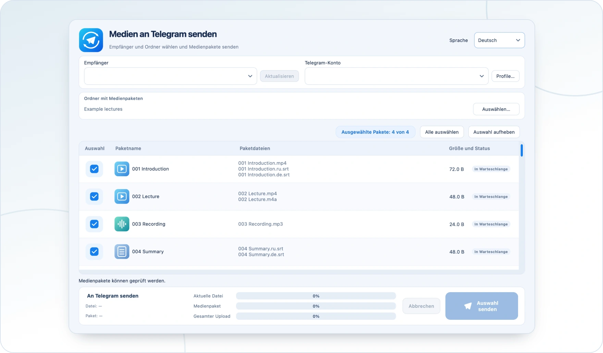

<!-- ppk-readme:head:start -->
<a href="https://popovantondev.github.io/TelegramMediaSender/index.html"><picture><source media="(prefers-color-scheme: dark)" srcset="https://raw.githubusercontent.com/popovantondev/TelegramMediaSender/main/docs/readme/header-de-dark.30c36a3d.svg"></picture></a>
<!-- ppk-readme:head:end -->

# Benutzerhandbuch

<!-- public-release:start -->
Sendet nummerierte Pakete aus Video, Audio und Untertiteln in der gewählten Reihenfolge an Telegram.

**macOS 13+ · Apple Silicon · Release 1.1.2**

**[Herunterladen](https://github.com/popovantondev/TelegramMediaSender/releases/tag/v1.1.2)** · **[Anleitung](https://popovantondev.github.io/TelegramMediaSender/Guide-de.html)** · **[Fehler melden](https://github.com/popovantondev/TelegramMediaSender/issues/new/choose)**

**Voraussetzungen und Grenzen:** Eigenes Telegram-Konto, API ID und API Hash erforderlich; keine Apple-Notarisierung.

**Erste Schritte:** ZIP entpacken, Telegram Media Sender.app nach Applications verschieben und die Verbindung nach Anleitung einrichten.

**App-Dateien:**

- [`TelegramMediaSender-1.1.2-macOS-arm64.zip`](https://github.com/popovantondev/TelegramMediaSender/releases/download/v1.1.2/TelegramMediaSender-1.1.2-macOS-arm64.zip)

**Prüfsummen:** [`SHA256SUMS.txt`](https://github.com/popovantondev/TelegramMediaSender/releases/download/v1.1.2/SHA256SUMS.txt)
<!-- public-release:end -->

[Deutsch](../de/README.md) · [Русский](../ru/README.md) · [English](../en/README.md)

<!-- ppk-readme:body:start -->

<a href="https://github.com/popovantondev/TelegramMediaSender/releases/tag/v1.1.2"><picture><source media="(prefers-color-scheme: dark)" srcset="https://raw.githubusercontent.com/popovantondev/TelegramMediaSender/main/docs/readme/btn-download-de-dark.80c248fe.svg"></picture></a>
<a href="https://popovantondev.github.io/TelegramMediaSender/index.html"><picture><source media="(prefers-color-scheme: dark)" srcset="https://raw.githubusercontent.com/popovantondev/TelegramMediaSender/main/docs/readme/btn-website-de-dark.94ba29d1.svg"></picture></a>
<a href="https://popovantondev.github.io/TelegramMediaSender/Guide-de.html"><picture><source media="(prefers-color-scheme: dark)" srcset="https://raw.githubusercontent.com/popovantondev/TelegramMediaSender/main/docs/readme/btn-guide-de-dark.e4856881.svg"></picture></a>
<a href="https://github.com/popovantondev/TelegramMediaSender/issues/new/choose"><picture><source media="(prefers-color-scheme: dark)" srcset="https://raw.githubusercontent.com/popovantondev/TelegramMediaSender/main/docs/readme/btn-bug-de-dark.171175e6.svg"></picture></a>

<a href="https://raw.githubusercontent.com/popovantondev/TelegramMediaSender/main/docs/images/app-de.png"><picture><source media="(prefers-color-scheme: dark)" srcset="https://raw.githubusercontent.com/popovantondev/TelegramMediaSender/main/docs/readme/preview-de-dark.a3bc8917.webp"></picture></a> 
<a href="https://raw.githubusercontent.com/popovantondev/TelegramMediaSender/main/docs/images/app-de.png">Ganzer Screenshot</a>

<picture><source media="(prefers-color-scheme: dark)" srcset="https://raw.githubusercontent.com/popovantondev/TelegramMediaSender/main/docs/readme/divider-dark.8ad4e668.svg"></picture>
<!-- ppk-readme:body:end -->

*Oberfläche mit Beispieldateien; kein Telegram-Konto ist verbunden.*

Telegram Media Sender sendet nummerierte Dateipakete aus einem lokalen Ordner an einen Telegram-Chat. Ein Paket kann Video, Audio und Untertitel in beliebiger Kombination enthalten. Der Chatverlauf wird nicht heruntergeladen.

## Erster Start

1. Laden Sie die ZIP-Datei aus GitHub Releases, entpacken Sie sie und verschieben Sie die App in den Ordner „Programme“.
2. Öffnen Sie die App. Die Builds sind nicht notarisiert. Wenn Gatekeeper den Start blockiert, prüfen Sie, ob die App von der Releases-Seite dieses Projekts stammt. Wählen Sie anschließend **Systemeinstellungen → Datenschutz & Sicherheit → Dennoch öffnen** nur, wenn Sie der Quelle vertrauen.
3. Fügen Sie ein Profil mit Ihrer Telegram-Telefonnummer sowie API ID und API Hash hinzu. Die Schritte stehen in [Telegram verbinden](telegram-setup.md).
4. Geben Sie den Telegram-Anmeldecode und, falls abgefragt, Ihr Passwort für die Zwei-Schritt-Verifizierung ein.
5. Laden Sie die Chats, wählen Sie den Zielchat und Ordner, markieren Sie Pakete und senden Sie sie.

## Medienpakete vorbereiten

Dateien mit derselben führenden Nummer bilden ein Paket, zum Beispiel `001 Lektion.ru.mp4`, `001 Lektion.ru.srt` und `001 Lektion.de.srt`. Die Pakete werden in numerischer Reihenfolge gesendet. Auch reine Video-, Audio- oder Untertitelpakete sind möglich. Leicht abweichende Untertitelnamen werden zugeordnet. Bei mehreren passenden Untertiteln derselben Sprache werden alle gesendet; die App zeigt vorher einen Hinweis.

Vor dem Upload vergleicht die App Dateinamen und Größen mit dem Verlauf des ausgewählten Chats. Prüfen Sie mögliche Treffer und entscheiden Sie, ob das Paket übersprungen, erneut gesendet oder der Vorgang abgebrochen werden soll. Medien werden nacheinander gesendet, Untertitel als separate Dokumente.

## Lokale Daten

Profile und Sitzungsdateien bleiben auf diesem Mac unter `~/Library/Application Support/TelegramMediaSender/MediaGroupSender`. Ohne benanntes Profil ist die Profilauswahl zunächst leer. Benannte Profile der früheren App können einmalig übernommen werden; deren unbenanntes Standardkonto wird nicht automatisch angelegt. Die lokale Profildatei ist nur für Ihr macOS-Konto zugänglich; die App lädt diese Daten nicht hoch. Behandeln Sie eine `.session`-Datei wie ein Passwort: nicht weitergeben und nicht hochladen. Beenden Sie die Sitzung in Telegrams Liste aktiver Geräte, wenn Sie eine Kopie vermuten.

Beim ersten Start richtet sich die Sprache nach macOS, falls Deutsch, Russisch oder Englisch eingestellt ist. Wählen Sie eine andere Sprache im Fenster und starten Sie die App neu. Die Fensterposition wird lokal gespeichert.
