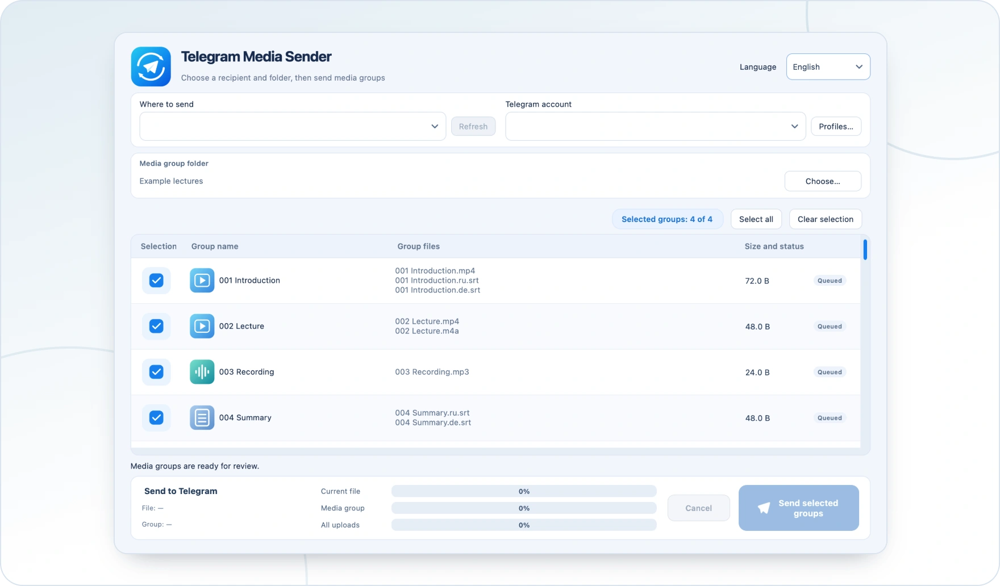

<!-- ppk-readme:head:start -->
<a href="https://popovantondev.github.io/TelegramMediaSender/index-en.html"><picture><source media="(prefers-color-scheme: dark)" srcset="https://raw.githubusercontent.com/popovantondev/TelegramMediaSender/main/docs/readme/header-en-dark.76717b7c.svg"></picture></a>
<!-- ppk-readme:head:end -->

# User guide

<!-- public-release:start -->
Send numbered bundles of video, audio and subtitles to Telegram in your chosen order.

**macOS 13+ · Apple Silicon · Release 1.1.2**

**[Download](https://github.com/popovantondev/TelegramMediaSender/releases/tag/v1.1.2)** · **[User guide](https://popovantondev.github.io/TelegramMediaSender/Guide-en.html)** · **[Report a problem](https://github.com/popovantondev/TelegramMediaSender/issues/new/choose)**

**Requirements and limitations:** Requires your own Telegram account, API ID and API Hash; not notarized by Apple.

**First steps:** Extract the ZIP, move Telegram Media Sender.app to Applications and follow the guide to connect Telegram.

**Application files:**

- [`TelegramMediaSender-1.1.2-macOS-arm64.zip`](https://github.com/popovantondev/TelegramMediaSender/releases/download/v1.1.2/TelegramMediaSender-1.1.2-macOS-arm64.zip)

**Checksums:** [`SHA256SUMS.txt`](https://github.com/popovantondev/TelegramMediaSender/releases/download/v1.1.2/SHA256SUMS.txt)
<!-- public-release:end -->

[Deutsch](../de/README.md) · [Русский](../ru/README.md) · [English](../en/README.md)

<!-- ppk-readme:body:start -->

<a href="https://github.com/popovantondev/TelegramMediaSender/releases/tag/v1.1.2"><picture><source media="(prefers-color-scheme: dark)" srcset="https://raw.githubusercontent.com/popovantondev/TelegramMediaSender/main/docs/readme/btn-download-en-dark.8d7fbaf0.svg"></picture></a>
<a href="https://popovantondev.github.io/TelegramMediaSender/index-en.html"><picture><source media="(prefers-color-scheme: dark)" srcset="https://raw.githubusercontent.com/popovantondev/TelegramMediaSender/main/docs/readme/btn-website-en-dark.972fd72a.svg"></picture></a>
<a href="https://popovantondev.github.io/TelegramMediaSender/Guide-en.html"><picture><source media="(prefers-color-scheme: dark)" srcset="https://raw.githubusercontent.com/popovantondev/TelegramMediaSender/main/docs/readme/btn-guide-en-dark.23ac2bcf.svg"></picture></a>
<a href="https://github.com/popovantondev/TelegramMediaSender/issues/new/choose"><picture><source media="(prefers-color-scheme: dark)" srcset="https://raw.githubusercontent.com/popovantondev/TelegramMediaSender/main/docs/readme/btn-bug-en-dark.53be7cba.svg"></picture></a>

<a href="https://raw.githubusercontent.com/popovantondev/TelegramMediaSender/main/docs/images/app-en.png"><picture><source media="(prefers-color-scheme: dark)" srcset="https://raw.githubusercontent.com/popovantondev/TelegramMediaSender/main/docs/readme/preview-en-dark.04715d1e.webp"></picture></a> 
<a href="https://raw.githubusercontent.com/popovantondev/TelegramMediaSender/main/docs/images/app-en.png">Full screenshot</a>

<picture><source media="(prefers-color-scheme: dark)" srcset="https://raw.githubusercontent.com/popovantondev/TelegramMediaSender/main/docs/readme/divider-dark.8ad4e668.svg"></picture>
<!-- ppk-readme:body:end -->

*Application interface with demonstration files; no Telegram account is connected.*

Telegram Media Sender sends numbered bundles of local files to a Telegram chat. A bundle can contain video, audio, subtitles, or any combination of them. It does not download archive history.

## First launch

1. Download the ZIP from GitHub Releases, unzip it, and move the app to Applications.
2. Open the app. Builds are not notarized. If Gatekeeper blocks a build, verify that it came from this project's Releases page, then use **System Settings → Privacy & Security → Open Anyway** only if you trust it.
3. Add a profile with the phone number, API ID, and API Hash for your own Telegram account. See [Telegram setup](telegram-setup.md).
4. Enter the code sent by Telegram and, if requested, your two-step verification password.
5. Load chats, select a destination, choose the folder, select groups, and send.

## Prepare media groups

Files with the same leading number form a bundle, for example `001 Lesson.ru.mp4`, `001 Lesson.ru.srt`, and `001 Lesson.de.srt`. Bundles are sent in numeric order. Video-only, audio-only, and subtitle-only bundles also work. Slightly different subtitle names can match. When several subtitles of one language match, all are included and the app warns before sending.

Before upload, the app checks the chosen chat for files with matching names and sizes. Review the matches and choose whether to skip them, send anyway, or cancel. Media files are sent in sequence; subtitles are sent as separate documents.

## Local data and privacy

Profiles and session files stay on this Mac under `~/Library/Application Support/TelegramMediaSender/MediaGroupSender`. The selector starts empty until a named profile exists. Named profiles from the earlier app can be imported once; its unnamed default account is not added automatically. Profile values are stored in a local file with macOS account-only permissions; the app does not upload them. Treat a `.session` file as a password: do not share, email, or upload it. Use Telegram's active sessions settings to revoke a session if you suspect it was copied.

## Languages and window

The first launch follows the macOS language when it is German, Russian, or English. Select another language in the app and restart to apply it. The window position is saved locally.
