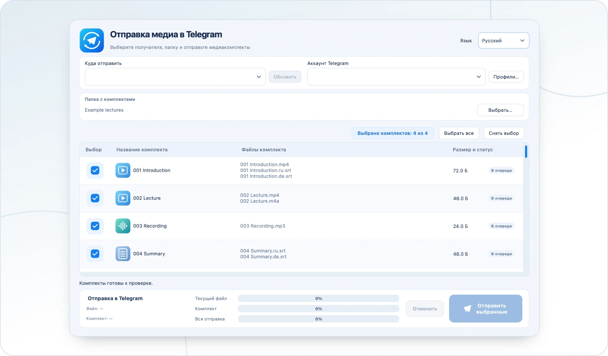

<!-- ppk-readme:head:start -->
<a href="https://popovantondev.github.io/TelegramMediaSender/index-ru.html"><picture><source media="(prefers-color-scheme: dark)" srcset="https://raw.githubusercontent.com/popovantondev/TelegramMediaSender/main/docs/readme/header-ru-dark.21ada65c.svg"></picture></a>
<!-- ppk-readme:head:end -->

# Руководство пользователя

<!-- public-release:start -->
Отправляет пронумерованные наборы видео, аудио и субтитров в Telegram в выбранном порядке.

**macOS 13+ · Apple Silicon · Выпуск 1.1.2**

**[Скачать](https://github.com/popovantondev/TelegramMediaSender/releases/tag/v1.1.2)** · **[Инструкция](https://popovantondev.github.io/TelegramMediaSender/Guide-ru.html)** · **[Сообщить об ошибке](https://github.com/popovantondev/TelegramMediaSender/issues/new/choose)**

**Требования и ограничения:** Нужны собственный аккаунт Telegram, API ID и API Hash; приложение не нотарифицировано Apple.

**Первые шаги:** Распакуйте архив, перенесите Telegram Media Sender.app в Applications и настройте подключение по руководству.

**Файлы приложения:**

- [`TelegramMediaSender-1.1.2-macOS-arm64.zip`](https://github.com/popovantondev/TelegramMediaSender/releases/download/v1.1.2/TelegramMediaSender-1.1.2-macOS-arm64.zip)

**Контрольные суммы:** [`SHA256SUMS.txt`](https://github.com/popovantondev/TelegramMediaSender/releases/download/v1.1.2/SHA256SUMS.txt)
<!-- public-release:end -->

[Deutsch](../de/README.md) · [Русский](../ru/README.md) · [English](../en/README.md)

<!-- ppk-readme:body:start -->

<a href="https://github.com/popovantondev/TelegramMediaSender/releases/tag/v1.1.2"><picture><source media="(prefers-color-scheme: dark)" srcset="https://raw.githubusercontent.com/popovantondev/TelegramMediaSender/main/docs/readme/btn-download-ru-dark.04694287.svg"></picture></a>
<a href="https://popovantondev.github.io/TelegramMediaSender/index-ru.html"><picture><source media="(prefers-color-scheme: dark)" srcset="https://raw.githubusercontent.com/popovantondev/TelegramMediaSender/main/docs/readme/btn-website-ru-dark.d3d04f61.svg"></picture></a>
<a href="https://popovantondev.github.io/TelegramMediaSender/Guide-ru.html"><picture><source media="(prefers-color-scheme: dark)" srcset="https://raw.githubusercontent.com/popovantondev/TelegramMediaSender/main/docs/readme/btn-guide-ru-dark.7653a777.svg"></picture></a>
<a href="https://github.com/popovantondev/TelegramMediaSender/issues/new/choose"><picture><source media="(prefers-color-scheme: dark)" srcset="https://raw.githubusercontent.com/popovantondev/TelegramMediaSender/main/docs/readme/btn-bug-ru-dark.83f1de3c.svg"></picture></a>

<a href="https://raw.githubusercontent.com/popovantondev/TelegramMediaSender/main/docs/images/app-ru.png"><picture><source media="(prefers-color-scheme: dark)" srcset="https://raw.githubusercontent.com/popovantondev/TelegramMediaSender/main/docs/readme/preview-ru-dark.8e89789b.webp"></picture></a> 
<a href="https://raw.githubusercontent.com/popovantondev/TelegramMediaSender/main/docs/images/app-ru.png">Снимок целиком</a>

<picture><source media="(prefers-color-scheme: dark)" srcset="https://raw.githubusercontent.com/popovantondev/TelegramMediaSender/main/docs/readme/divider-dark.8ad4e668.svg"></picture>
<!-- ppk-readme:body:end -->

*Интерфейс с демонстрационными файлами; аккаунт Telegram не подключён.*

Telegram Media Sender отправляет из локальной папки пронумерованные комплекты файлов в выбранный чат Telegram. Комплект может содержать видео, аудио, субтитры или любое их сочетание. Программа не скачивает историю архива.

## Первый запуск

1. Скачайте ZIP из GitHub Releases, распакуйте его и переместите приложение в «Программы».
2. Откройте приложение. Сборки не нотариально заверены. Если Gatekeeper блокирует запуск, проверьте, что приложение скачано со страницы Releases этого проекта, затем откройте **Системные настройки → Конфиденциальность и безопасность → Открыть всё равно**, только если доверяете источнику.
3. Добавьте профиль со своим номером Telegram, API ID и API Hash. Подробности — в инструкции [Подключение Telegram](telegram-setup.md).
4. Введите код входа, присланный Telegram, а при запросе — пароль двухэтапной проверки.
5. Загрузите список чатов, выберите чат и папку, отметьте комплекты и отправьте их.

## Подготовка комплектов

Файлы с одинаковым номером в начале имени составляют один комплект, например `001 Урок.ru.mp4`, `001 Урок.ru.srt` и `001 Урок.de.srt`. Комплекты отправляются по порядку номеров. Допустимы только видео, только аудио, только субтитры и видео со звуком без субтитров. Небольшие различия в именах субтитров допустимы. Если одному языку подходят несколько файлов, будут отправлены все; программа предупредит об этом.

Перед отправкой программа проверяет историю выбранного чата на файлы с совпадающими именами и размерами. Проверьте найденные совпадения и выберите, пропустить комплект, отправить его повторно или отменить операцию. Медиафайлы отправляются последовательно, субтитры — отдельными документами.

## Локальные данные

Профили и файлы сессий хранятся на этом Mac в `~/Library/Application Support/TelegramMediaSender/MediaGroupSender`. Пока нет профиля с заданным именем, список профилей пуст. Именованные профили старой программы могут быть перенесены один раз; её безымянный стандартный аккаунт автоматически не добавляется. Локальный файл профиля доступен только вашей учётной записи macOS; приложение не загружает эти данные. Файл `.session` следует считать паролем: не передавайте и не загружайте его. Если есть подозрение, что сессия скопирована, завершите её в настройках активных устройств Telegram.

При первом запуске язык выбирается по языку macOS, если он немецкий, русский или английский. Выберите другой язык в окне программы и перезапустите приложение. Положение окна запоминается локально.
